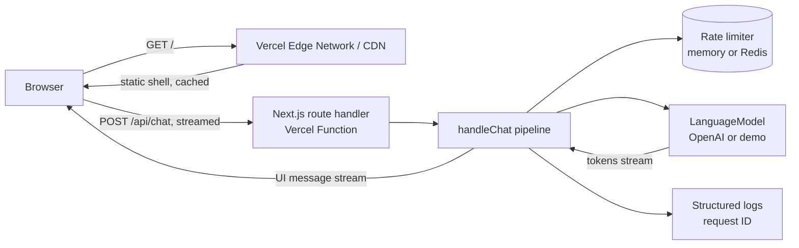
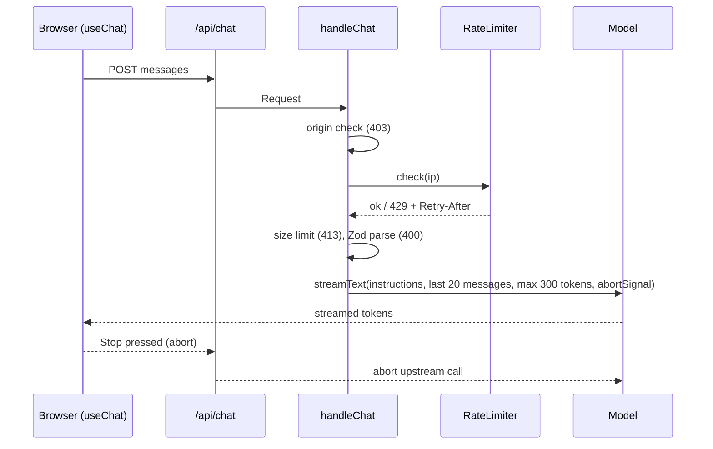

# Architecture and system design

This document explains how the chatbot is built, why, and how to scale it.

## Goals

| Goal | How |
| --- | --- |
| Fast first paint | Static shell prerendered (Partial Prerendering), heavy chat JS loaded after paint |
| Low cost per user | Short history, capped output, rate limits, stop cancels the model call |
| Safe with an API key on the server | Validation at the boundary, origin checks, no secrets in prompts or the browser |
| Easy to change per client | Facts in one file, limits in one file, model in one file |
| Testable | Request pipeline is plain TypeScript with injected dependencies |

## System overview



## Layers

```
app/                 Routing only (pages, route handlers, metadata files)
features/chat/       Everything about chat, grouped by feature
  components/        Client UI (React), no server imports
  server/            Server-only logic, marked with "server-only"
  config.ts          Shared limits (safe for client and server)
  schema.ts          Zod validation of untrusted input
  instructions.ts    Business facts for the model
server/              Cross-cutting server code (env, logging)
config/              Public site config (SEO)
```

Rules:

1. `app/` files stay thin. They call into a feature.
2. Client components never import from `server/`. `server-only` makes the build fail if they do.
3. The request pipeline (`handle-chat.ts`) has no Next.js imports. It takes a `Request` and returns a `Response`, so it runs in tests and could move to another runtime.
4. Dependencies (model, rate limiter, logger) are injected in one composition root (`features/chat/server/index.ts`).

## Request lifecycle



## Key decisions

**Stream with the AI SDK UI message protocol.** `useChat` and `toUIMessageStreamResponse` handle partial messages, stop and retry. Writing this by hand would add bugs with no benefit.

**Validate and normalize on the server.** The client is untrusted. Only `user` and `assistant` text parts are accepted, so a client cannot inject a `system` message, files or tool results.

**Ports and adapters for the model and rate limiter.** `getModel()` returns an AI SDK `LanguageModel`. Switching to Anthropic, Gemini or a gateway is one line. `RateLimiter` is an interface, so production can use Redis without touching the pipeline.

**Demo model instead of mocks in the UI.** The demo uses the AI SDK's own mock model, so the real streaming path runs end to end with no key and no cost. The same model powers the tests.

**Partial Prerendering + lazy client.** The page shell, title and SEO tags are static HTML. The demo badge streams in through Suspense because it reads env at request time. The AI SDK client (the largest JS) loads in its own chunk behind a same-size skeleton, so there is no layout shift.

**Generic errors, detailed logs.** Users see short messages. Logs carry the `x-request-id` so a support ticket can be matched to a server log line.

## Scaling and production checklist

| Concern | Today | At scale |
| --- | --- | --- |
| Rate limiting | In memory, per instance | Shared store (Upstash Redis / Vercel KV) via `RateLimiter` |
| Abuse | Origin check + limits | Add bot protection (Vercel BotID / Turnstile) and per-user limits after login |
| Cost | Token caps, short history | Spend alerts, usage per user, cheaper model for simple intents |
| Knowledge | Facts in the prompt | Retrieval (RAG) over a document store when facts grow past a page |
| Persistence | None (stateless) | Store chats in Postgres for history and analytics |
| Observability | JSON logs + request IDs | Ship logs to a log drain, add tracing (OpenTelemetry) |
| Reliability | One provider | Fallback model or AI gateway with retries |

## Testing strategy

- **Unit:** schema rules, rate limiter windows.
- **Integration:** `handleChat` with real `Request` objects and the demo model (status codes, headers, streaming).
- **CI:** lint, type-check, tests and a production build on every push and pull request.
